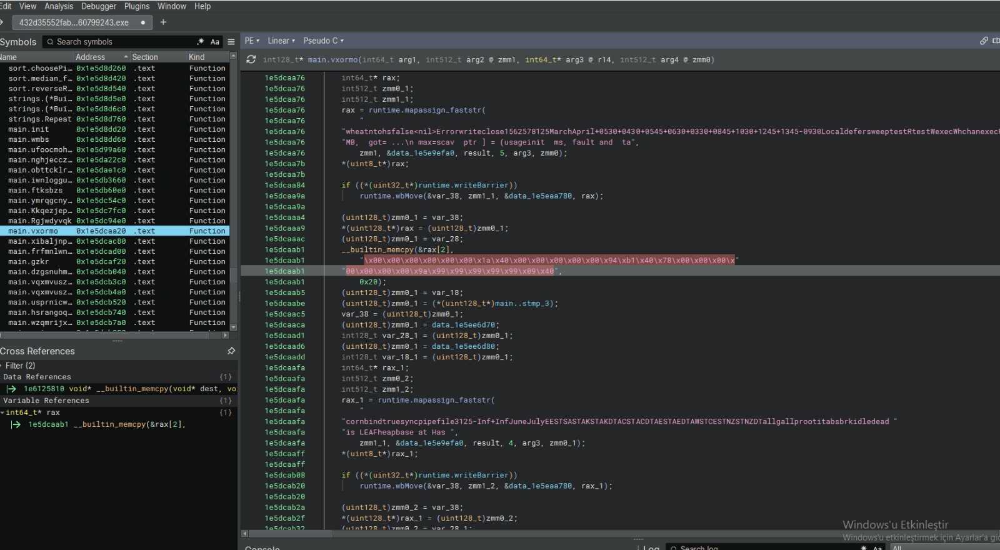
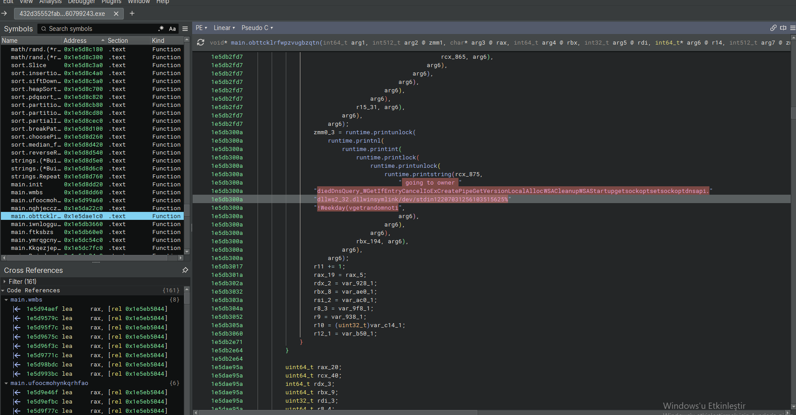
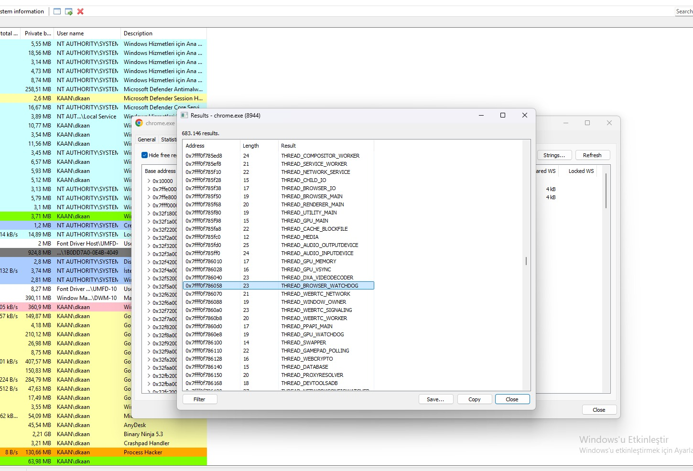
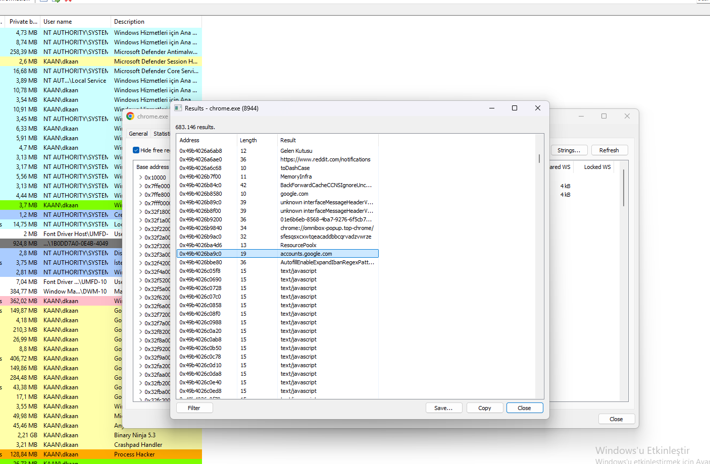
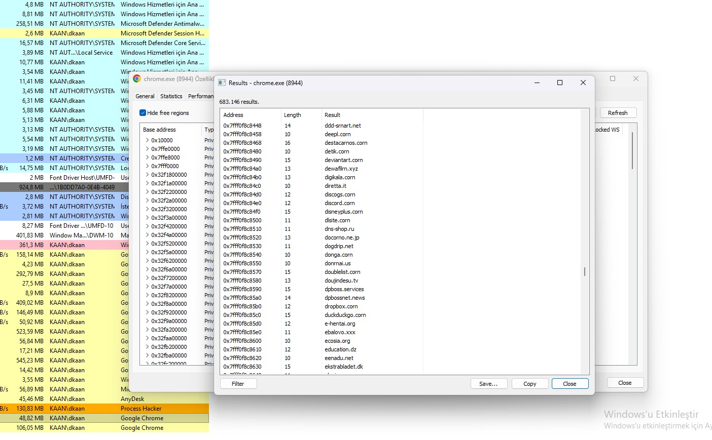

## 1. Binary Ninja – Obfuscation & In-Memory Payload Construction

The Vidar Stealer sample loaded in Binary Ninja displays heavily obfuscated code within the main.vxormo function. The analysis reveals that the malware relies on string encryption, custom XOR routines, and runtime memory assembly to hide its true behavior. The \x00-heavy byte arrays (x00\x00\x00...) in the pseudo-C view indicate that raw payload fragments are being constructed directly in memory.

### Key Observations:

**Obfuscated Functions**: Randomly generated names like main.vxormo, main.oqvmwusz, and main.dzgsnuhm are used to obscure functionality.
**Obfuscated Strings**: whatnthotsfalse... and cornbindtrue... are encrypted strings that are resolved at runtime.
**Custom XOR Routine**: The vxormo function name itself suggests a custom XOR decryption loop is active.
**In-Memory Payload Construction**: Arrays containing \x00, \x89, \x99, \x48 bytes are being written to memory using _builtin_memcpy.The *uint8_t*)rax pointer shows raw shellcode/payload fragments being assembled.

### Why This Matters:

**Defeating Static Analysis**: The use of randomly named functions and encrypted strings means static signature-based AVs will fail to identify the payload.
**In-Memory Execution (Fileless)**: The \x00 payload is never dropped to disk; it is allocated and executed directly in memory (RWX), evading file scanners.
**Custom XOR Encryption**: A custom XOR routine prevents simple string extraction or YARA rule matching.
**Data Hiding**: The massive, unreadable arrays (\x00\x00\x00\x01...) are likely encrypted configuration blocks (C2 URLs, grabber modules) that are decrypted only when needed.

### Visual Reference:

## 2. Binary Ninja – Anti-Forensics & Environment Cleanup

A second view of the Vidar Stealer sample in Binary Ninja reveals a function (main.obttcklrlfwpzvugbzqtn) dedicated to system reconnaissance and anti-forensic cleanup. The function processes encrypted strings and resolves API names to wipe traces of its execution, specifically targeting DNS caches, event logs, and temporary internet files before dropping the final payload.

### Key Observations:

**Obfuscated API Resolution**: The string ...DiednsQuery_WGGetIfEntryCancelIoExCreatePipe... is an encrypted concatenation of WinAPI calls
**Cleanup APIs Identified**: **DnsQuery_W** / **DnsFlushResolverCache** – flushes DNS cache to hide C2 domain resolution traces.
**GetIfEntry**– enumerates network interfaces (checking for sandbox/virtual adapters).
**WinExec** – dynamically executes system cleanup utilities (e.g., cmd.exe /c del ...).
**Syscall/Script Execution**: References to dllws2_32.dll and /dev/stdin (standard input redirection) indicate the malware prepares to interact with the system's standard streams or network stack.

### Why This Matters:

**Anti-Forensics**: Flushing the DNS cache (DnsFlushResolverCache) and invoking cleanup routines ensures that network logs and local artifacts are destroyed, hindering incident response.
**Sandbox Evasion**: Querying network interfaces (GetIfEntry) allows the stealer to detect virtualized environments (e.g., VMware, VirtualBox) and abort execution if a sandbox is detected
**Spoofing Execution Flow**: Using WinExec for cleanup means the malware doesn't need to statically import deletion APIs; it delegates the dirty work to the OS.
**Fileless Interaction**: /dev/stdin redirection and pipe usage (CreatePipe) allow the stealer to pass stolen data to an injected process or a command shell without touching the disk.

### Visual Reference:

## 3. Process Hacker – Chrome Process Injection (Hollowing)

The Process Hacker memory view of the chrome.exe process (PID 8944) confirms that the Vidar Stealer has injected its payload directly into the browser's memory space. The string scan exposes multiple thread execution blocks, a standard artifact of process hollowing or remote thread injection. By injecting into Chrome, the stealer operates under a trusted, high-integrity process to silently harvest cookies, saved credentials, and session tokens.

### Key Observations:

**Injected Threads (Memory Strings)**: THREAD_BROWSER_WATCHDOG / THREAD_GPU_WATCHDOG – watchdogs hijacked to keep the injected threads alive.
**THREAD_CACHE_BLOCKFILE** – indicates manipulation of Chrome's cache (likely for extracting session data).
**THREAD_AUDIO_INPUTDEVICE** / THREAD_GAMEPAD_POLLING – non-essential threads repurposed to mask malicious activity.
**THREAD_WEBCRYPTO** – highly suspicious; Chrome's internal crypto API is used to decrypt saved passwords and cookies.
**THREAD_PROXYRESOLVER** / THREAD_DATABASE – used to intercept network traffic and access the local credential database.

### Why This Matters:

**Browser Credential Theft**: Hooking THREAD_WEBCRYPTO and THREAD_DATABASE allows Vidar to bypass Chrome's encryption and steal saved passwords and cookies.
**Living off the Land**: By injecting into chrome.exe, the malware masquerades as legitimate browser traffic, easily bypassing firewalls and EDR network rules.
**Process Hollowing**: The presence of standard Chrome threads alongside injected ones means the malware likely hollowed a legitimate thread or used CreateRemoteThread.
**Session Hijacking**: THREAD_CACHE_BLOCKFILE and cookie extraction allow the attacker to steal active sessions (session hijacking) without needing the user's password.
**Evasion**: Antivirus solutions rarely scan inside the memory space of a signed browser like Chrome.

### Visual Reference:

## 4. Process Hacker – Chrome Injected Strings & Credential Target Hooking

A deeper look into the injected memory space of chrome.exe (PID 8944) reveals a collection of strings specifically targeting Google authentication flows, Reddit sessions, and browser JavaScript execution. The presence of these strings confirms that the Vidar Stealer injects malicious JavaScript or hooks browser APIs to intercept login credentials and session tokens.

### Key Observations:

**Credential / Authentication Targets**: accounts.google.com – specifically targets Google account login pages for credential theft.
https://www.reddit.com/notifications – monitors Reddit session activity (likely cookie theft).
**Gelen Kutusu** (Turkish for "Inbox") – indicates targeting of email or messaging interfaces.
**toDashCase** / **MemoryInfra** / **BackForwardCacheCSIgnoreUnc...** – Chrome's internal memory and rendering flags
**AutoFillEnableExpandIframeRegexPatt...** – manipulation of Chrome's AutoFill functionality to capture saved passwords/forms
**Multiple text/javascript**: entries confirm that Vidar is injecting and executing malicious JavaScript directly within the browser context.
**ResourcePool** / **sfsssqcxxwqecaddbbbcqpvadzvwrze** – likely an encrypted C2 endpoint or randomly generated session identifier.

### Why This Matters:

**Targeted Credential Harvesting**: Specifying accounts.google.com shows Vidar is not just blindly scraping; it is actively targeting high-value authentication portals.
**Browser API Hooking**: Strings like AutoFillEnableExpandIframeRegexPatt prove Vidar manipulates Chrome's AutoFill engine to intercept saved credentials and form data
**JavaScript Injection**: The heavy presence of text/javascript in memory means Vidar executes scripts inside the browser to read cookies (document.cookie) and bypass HTTPOnly protections.
**Mojo IPC Abuse**: interfaceMessageHeader indicates the stealer is communicating with Chrome's internal IPC (Mojo) to extract data directly from the browser's sandboxed processes.
**Session Hijacking**: Targeting Reddit notifications and inboxes confirms the goal is active session hijacking (cookie theft) rather than just static password dumping.

### Visual Reference:

## 5. Process Hacker – Decoy Domains & Anti-Analysis Techniques

A final look into the chrome.exe (PID 8944) memory space reveals a massive list of domains that are not C2 servers, but rather decoy domains used for anti-analysis and sandbox evasion. Strings like ddt-smart.net, deepL.com, dropbox.com, and numerous others are hardcoded into the injected payload. This is a classic domain flooding technique designed to overwhelm security analysts and automated sandboxes.

### Key Observations:

**Decoy Domain List** (Partial): Legitimate:**deepL.com**, **dropbox.com**, **deviantart.com**, **discord.com**, **ebay.com**.
**Fake / Random**: **ddt-smart.net**, **destacamos.com**, **dfk.com**, **donga.com**, **dzgsnuhm.com**.
**Region-specific**: **dokomo.ne.jp**, **doujin.desu.tv**, **e-hantal.org** (Middle East / Asia targets).
**No Direct C2 Indicator**: None of these domains match known Vidar C2 infrastructure; they are likely passed to the sandbox/AV to waste its time.

### Why This Matters:

**Domain Flooding** (Anti-Analysis): Vidar injects dozens of random and legitimate domains into memory to flood automated sandboxes (like Any.run or Cuckoo) with useless network requests. Security analysts waste time analyzing benign traffic.
**False Positives**: If an analyst extracts the domain list from memory, they may falsely flag legitimate sites (like dropbox.com or deepL.com) as C2, leading to incorrect IOCs and broken rules.
**Sandbox Timeout**: The constant DNS queries and HTTP requests to these decoys consume sandbox resources and time limits, allowing the real C2 connection to slip through or run after the sandbox has stopped.
**TLD Diversity**: The domains span .com, .net, .jp, .tv, .org, and .de, making pattern-based blocking rules ineffective.

### Visual Reference:

### Conclusion:

The analysis of the Vidar Stealer sample confirms it is a highly sophisticated, fileless information stealer with advanced evasion and anti-forensic capabilities. Through Binary Ninja and Process Hacker, we observed the malware constructing its payload directly in memory, injecting into the chrome.exe process to hook internal APIs, and flooding the environment with decoy domains to thwart analysis.

### Key Observations:

**In-Memory Payload Construction**: The main.vxormo function utilizes heavy obfuscation and custom XOR routines (\x00 byte arrays) to decrypt and execute payload fragments without touching the disk.
**Anti-Forensics**: The malware dynamically resolves APIs to flush the DNS cache (DnsFlushResolverCache) and clear system logs, destroying evidence of its activity.
**Process Injection** (Hollowing): Vidar successfully injects its threads into chrome.exe, masquerading as legitimate browser processes (THREAD_WEBCRYPTO, THREAD_BROWSER_WATCHDOG) to evade EDR detection.
**Domain Flooding** (Anti-Analysis): The injection routine populates Chrome's memory with hundreds of decoy domains (e.g., dropbox.com, deepL.com) to overwhelm sandboxes and mislead analysts into extracting false IOCs.

### Overall Assessment:

Vidar Stealer remains a potent threat, evolving from a simple credential grabber to a highly evasive, browser-focused stealer. Its ability to operate entirely in memory (fileless), abuse legitimate browser internals, and deploy massive domain noise makes traditional signature-based detection ineffective. The malware’s primary goal is the rapid exfiltration of saved passwords, cookies, and crypto-wallet data.

🛡️ Support My Research

If this malware analysis helped you or saved you time in your reverse engineering journey, feel free to support my research! You can buy me a coffee or become a sponsor through my GitHub Sponsors page. Any support helps me reverse engineer more advanced threats! 🛡️

### Sample Download

The analyzed Vidar Stealer sample is available on MalwareBazaar for those who wish to conduct their own analysis:

[Vidar Stealer Sample on MalwareBazaar](https://bazaar.abuse.ch/sample/432d35552fab5f79fe7f4af9ea62b2f9e777583d8bff12dda0b1f86b60799243)

**Tools Used:** Process Hacker, Binary Ninja,x64dbg
